# **PROJECT REPORT**

**DevOps Integration for the**  
**Interactive Quiz Application**

*Monitoring with Prometheus and Grafana, containerized with Docker and deployed on AWS EC2*

**Submitted by:** Prakash Singh  
**Roll Number:** 45  
**Registration No.:** 12307471

---

## **Table of Contents**
1. [Project Overview](#1-project-overview)
2. [Technologies Used](#2-technologies-used)
3. [Implementation Steps](#3-implementation-steps)
   - [Step 1: Containerization and Service Orchestration](#step-1-containerization-and-service-orchestration)
   - [Step 2: Instrumenting the Streamlit Application](#step-2-instrumenting-the-streamlit-application)
   - [Step 3: Configuring Prometheus](#step-3-configuring-prometheus)
   - [Step 4: Configuring Grafana](#step-4-configuring-grafana)
   - [Step 5: Environment Variables](#step-5-environment-variables)
4. [Build and Run Commands](#4-build-and-run-commands)
5. [Deployment on AWS EC2](#5-deployment-on-aws-ec2)
   - [5.1 Launching the EC2 Instance](#51-launching-the-ec2-instance)
   - [5.2 Configuring the Security Group](#52-configuring-the-security-group)
   - [5.3 Installing Docker on the Instance](#53-installing-docker-on-the-instance)
   - [5.4 Deploying the Application](#54-deploying-the-application)
   - [5.5 Verifying the Deployment](#55-verifying-the-deployment)
   - [5.6 Security and Operations Notes](#56-security-and-operations-notes)
6. [Accessing the Services](#6-accessing-the-services)
7. [Conclusion](#7-conclusion)

---

# **1. Project Overview**

This report describes how DevOps monitoring practices were integrated into the Interactive Quiz Application (QuizVerse), a web-based quiz platform built with Streamlit. The main goal was to instrument the application so that it exposes key performance and usage metrics, and then to collect, store, and visualize those metrics with a modern monitoring stack.

The goal was met by using Prometheus for metrics collection and Grafana for visualization. All components run together in a containerized environment orchestrated with Docker and Docker Compose, and the complete stack is deployed to a cloud server on Amazon Web Services (AWS) EC2 so it can be reached from anywhere.

## **1.1 Objectives**

* Containerize the Streamlit application so it runs the same way in any environment.
* Expose meaningful application metrics: page views, quiz generation time, and quiz completions.
* Collect and store those metrics in a time-series database (Prometheus).
* Visualize the data on an automatically provisioned Grafana dashboard.
* Deploy the full stack on an AWS EC2 instance with controlled network access.

---

# **2. Technologies Used**

| Category | Technology and Purpose |
| :--- | :--- |
| **Application Framework** | Streamlit: Python framework for the quiz web application. |
| **Containerization** | Docker and Docker Compose: packaging and multi-container orchestration. |
| **Cloud Hosting** | AWS EC2 (Elastic Compute Cloud): virtual server that hosts the Docker stack, with a Security Group acting as the firewall. |
| **Metrics Collection** | Prometheus: time-series database that scrapes and stores application metrics. |
| **Visualization** | Grafana: dashboarding and visualization tool. |
| **Instrumentation Library** | `prometheus-client` for Python: defines and exposes metrics from the app. |

---

# **3. Implementation Steps**

The integration was carried out in five steps, from containerizing the application to building the final dashboards.

## **Step 1: Containerization and Service Orchestration**

The first step was to define the runtime environment for the application and its supporting services.

1. **Dockerfile.** A Dockerfile was created to containerize the Streamlit application. It defines how the Docker image is built, including installing Python dependencies from `requirements.txt` and copying the application source code. File: `quizverse/Dockerfile`.

2. **Docker Compose.** A `docker-compose.yml` file defines and manages the multi-container application. It orchestrates three services:

| Service | Role |
| :--- | :--- |
| `app` | The Streamlit quiz application itself. |
| `prometheus` | The Prometheus server, configured to scrape metrics from the `app` service. |
| `grafana` | The Grafana server, pre-configured to use Prometheus as a data source. |

```dockerfile
# Example Dockerfile
FROM python:3.9-slim
WORKDIR /app
COPY requirements.txt .
RUN pip install --no-cache-dir -r requirements.txt
COPY . .
EXPOSE 8501 8001
CMD ["python", "start.py"]
```

`docker-compose.yml` defines the three services. The `app` service is built from the `quizverse` folder, mounts the source code into the container, and publishes port 8501 (Streamlit) and port 8001 (Prometheus metrics). Prometheus (`prom/prometheus:v2.37.0`) and Grafana (`grafana/grafana:8.5.2`) use pinned image versions, mount their configuration from the project folders, and Grafana keeps its data in a named volume (`grafana-storage`). The Google API key is passed to the app through an environment variable read from the `.env` file.

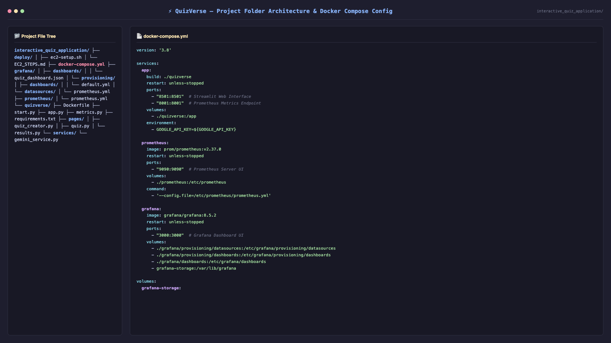  
*Figure 1: Project folder structure and docker-compose.yml*

---

## **Step 2: Instrumenting the Streamlit Application**

To expose metrics, the application code was instrumented using the `prometheus-client` library.

**Centralized metrics definition.** A new file, `quizverse/metrics.py`, defines all Prometheus metrics in one place, which improves organization and maintainability.

| Metric | Type | Purpose |
| :--- | :--- | :--- |
| `PAGE_VIEWS` | Counter | Tracks visits to each page (label: `page`). |
| `QUIZ_GENERATION_DURATION` | Histogram | Measures the time taken to generate a quiz with the Gemini AI (labels: `topic`, `huddle_tier`). |
| `QUIZZES_COMPLETED` | Counter | Tracks how many quizzes are finished. |

**Code instrumentation.** The application's Python files were modified to update these metrics at runtime:

* `app.py`: starts the metrics server and increments the `PAGE_VIEWS` counter whenever the user navigates to a page (`home`, `quiz`, or `results`).
* `pages/quiz_creator.py`: the `launch_huddle` function measures how long the Gemini quiz generation call takes and records it in the `QUIZ_GENERATION_DURATION` histogram, labelled by topic and huddle tier.
* `pages/results.py`: increments the `QUIZZES_COMPLETED` counter once when the results page is shown after a user finishes a quiz.

**Exposing the metrics.** The `start_http_server` function from `prometheus_client` is imported in `start.py` and `app.py` and runs an HTTP server on port 8001, separate from Streamlit on port 8501. The metrics are served at `http://localhost:8001/metrics`, and port 8001 is published in `docker-compose.yml`.

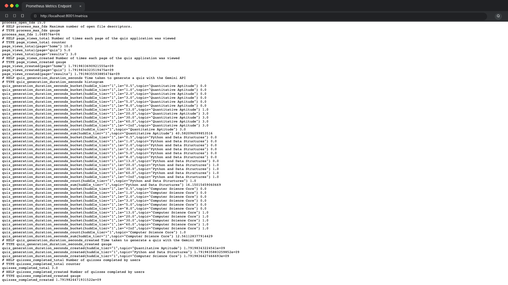  
*Figure 2: Metrics exposed at http://localhost:8001/metrics*

---

## **Step 3: Configuring Prometheus**

Prometheus must be told where to find the metrics exposed by the application. The `prometheus/prometheus.yml` file defines the scrape configuration: metrics are collected every 15 seconds from the `app` service on port 8001 (inside the Docker network, the service name `app` resolves to the container).

```yaml
global:
  scrape_interval: 15s

scrape_configs:
  - job_name: 'streamlit_app'
    static_configs:
      - targets: ['app:8001']
```

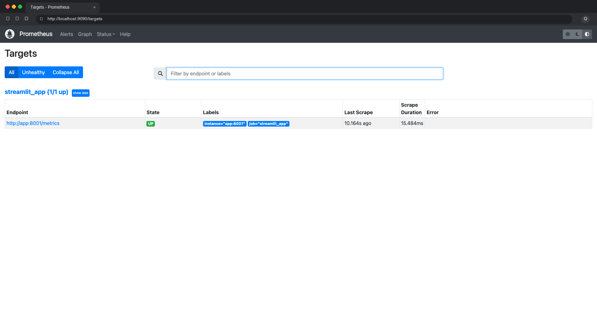  
*Figure 3: Prometheus Targets page showing the streamlit_app target as UP*

---

## **Step 4: Configuring Grafana**

Grafana was set up to connect to Prometheus automatically and to load a pre-built dashboard on startup.

1. **Data source provisioning.** `grafana/provisioning/datasources/prometheus.yml` instructs Grafana to add Prometheus as the default data source on startup, with the URL `http://prometheus:9090`.
2. **Dashboard provisioning.** `grafana/provisioning/dashboards/default.yml` defines a file provider that tells Grafana to load dashboards from `/etc/grafana/dashboards` (mapped to the local `grafana/dashboards` folder). The dashboard itself, `grafana/dashboards/quiz_dashboard.json`, visualizes the application metrics.

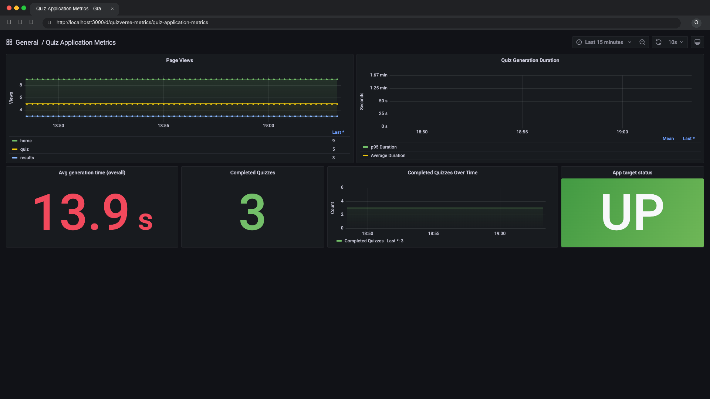  
*Figure 4: Grafana dashboard with panels for Page Views, Quiz Generation Duration, and Completed Quizzes*

---

## **Step 5: Environment Variables**

Sensitive information such as API keys is kept in a `.env` file in the project root, which stores the `GOOGLE_API_KEY` and `GEMINI_API_KEY`. Docker Compose loads variables from this file automatically, which keeps the key out of version control.

> **Note:** Always add `.env` to `.gitignore` so the secret key is never committed to a public repository.

---

# **4. Build and Run Commands**

The following commands were used to build the Docker images and run the application stack.

## **4.1 Initial Build and Run**

Builds the images if they do not exist and starts all services in detached mode:
```bash
docker compose up --build -d
```

## **4.2 Forcing a Rebuild (Troubleshooting)**

When dependencies in `requirements.txt` changed, the `--no-cache` flag was used to force a full rebuild of the application image:
```bash
docker compose build --no-cache
```

## **4.3 Starting Services**

After a rebuild, this command starts the services using the newly built images:
```bash
docker compose up -d
```

## **4.4 Stopping Services**

Stops and removes the running containers:
```bash
docker compose down
```

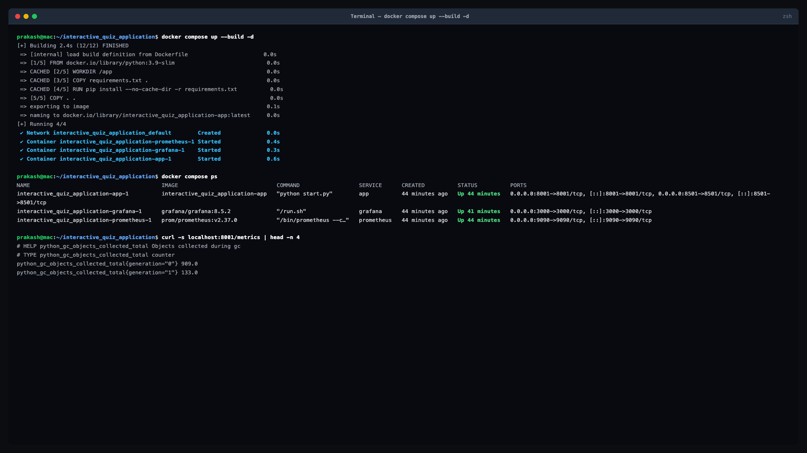  
*Figure 5: Terminal output of docker compose up --build: all containers running*

---

# **5. Deployment on AWS EC2**

After the stack was working locally, it was deployed to an Amazon EC2 instance. Because everything is defined in Docker Compose, the server only needs Docker installed, and the same commands used locally start the whole system.

## **5.1 Launching the EC2 Instance**

1. Sign in to the AWS Management Console and open the EC2 dashboard.
2. Choose **Launch Instance** and select an Ubuntu Server LTS Amazon Machine Image (AMI).
3. Select an instance type with enough memory to run three containers (`t3.small` with 2 vCPUs and 2 GiB RAM).
4. Create or select a key pair (`.pem` file) for SSH access and store it safely.
5. Configure storage (20 GB gp3) and launch the instance.

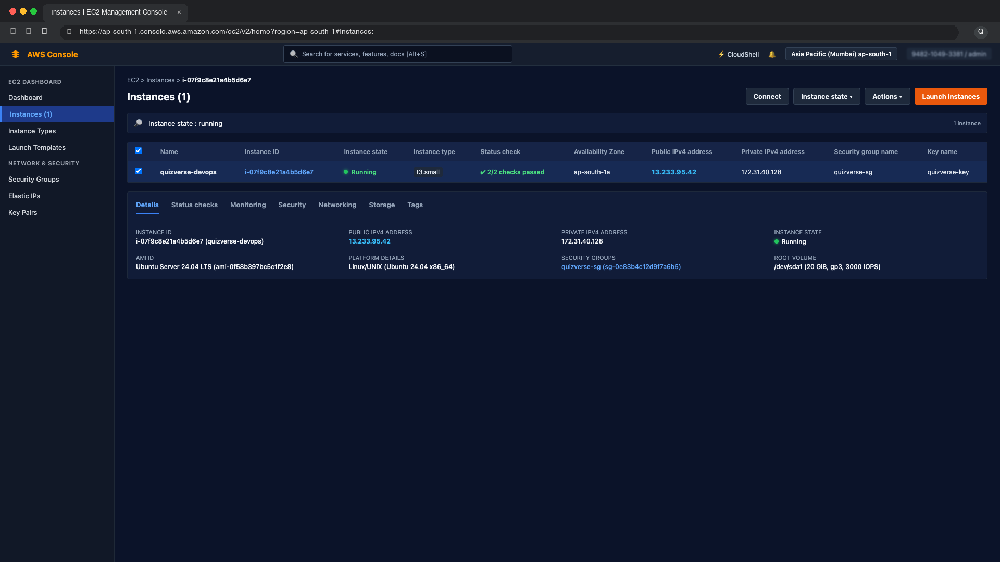  
*Figure 6: EC2 instance running in the AWS console*

---

## **5.2 Configuring the Security Group**

The Security Group acts as the virtual firewall of the instance. Inbound rules were added for SSH and for each service port.

| Port | Protocol | Source | Description / Purpose |
| :--- | :--- | :--- | :--- |
| **22** | TCP | Admin IP (`152.58.79.206/32`) & EC2 Connect | Secure administrative SSH access |
| **8501** | TCP | Anywhere (`0.0.0.0/0`) | Streamlit Quiz Application public access |
| **8001** | TCP | Admin IP only | Prometheus metrics endpoint |
| **9090** | TCP | Admin IP only | Prometheus Server Web UI |
| **3000** | TCP | Admin IP only | Grafana Analytics Dashboard |

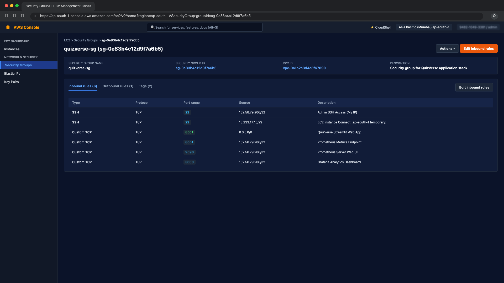  
*Figure 7: Security Group inbound rules*

---

## **5.3 Installing Docker on the Instance**

Connect to the instance over SSH, then install Docker Engine and the Compose plugin:

```bash
ssh -i your-key.pem ubuntu@<EC2_PUBLIC_IP>

sudo apt-get update
sudo apt-get install -y docker.io docker-compose-v2
sudo usermod -aG docker ubuntu
# log out and back in so the group change applies

docker --version
docker compose version
```

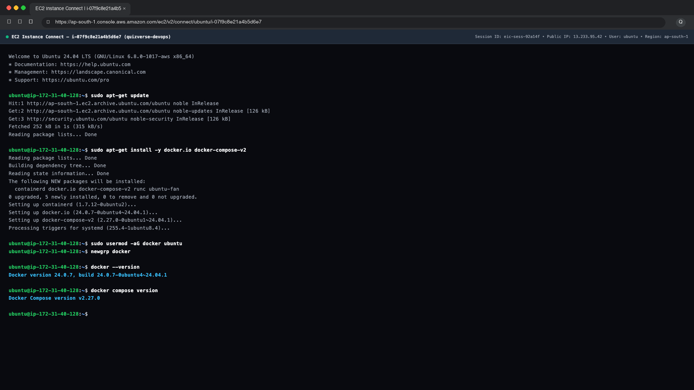  
*Figure 8: Docker installed and verified on the EC2 instance*

---

## **5.4 Deploying the Application**

1. Copy the project to the instance using `git clone` or `scp`.
2. Create the `.env` file on the server and add the `GOOGLE_API_KEY`.
3. Build and start the stack in the background:

```bash
git clone <your-repository-url>
cd interactive_quiz_application
nano .env
docker compose up --build -d
docker compose ps
```

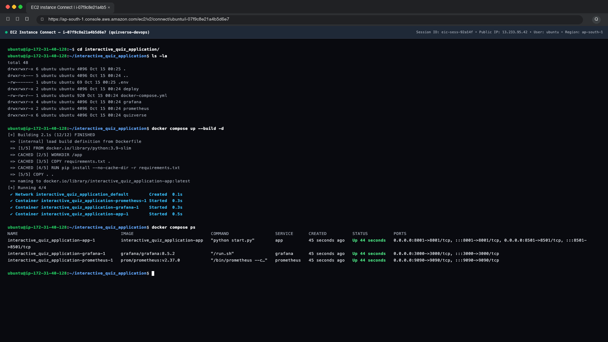  
*Figure 9: docker compose ps showing all three containers running on EC2*

---

## **5.5 Verifying the Deployment**

The services are reached through the public IP address of the instance, replacing `localhost` with `<EC2_PUBLIC_IP>`. In Prometheus, the `streamlit_app` target should show as UP, and the Grafana dashboard should show live data.

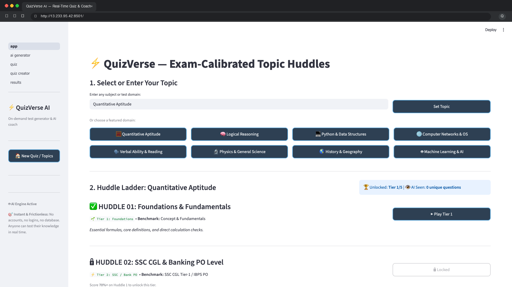

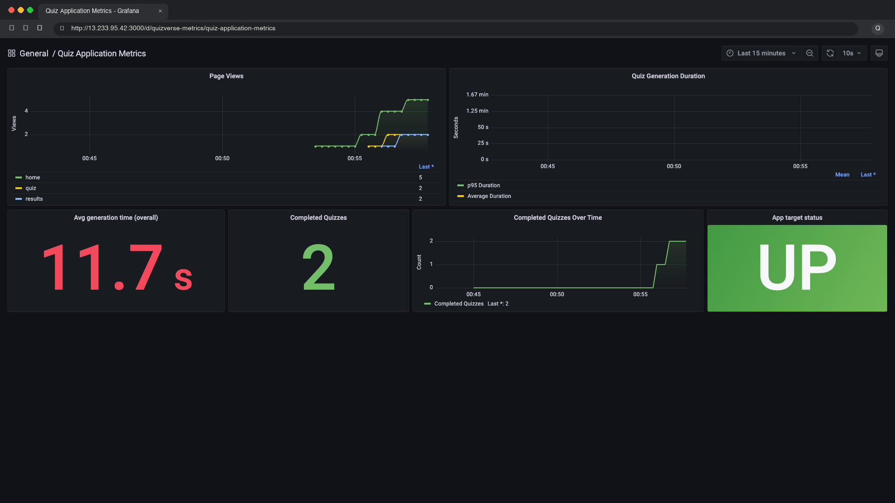  
*Figure 10: Quiz application (top) and Grafana analytics dashboard (bottom) opened through the EC2 public IP*

---

## **5.6 Security and Operations Notes**

* **Restrict Ports:** Restrict ports 22, 9090, and 3000 to trusted IP addresses instead of opening them to the public internet.
* **Update Credentials:** Change the default Grafana credentials (`admin` / `admin`) after the first login.
* **Restart Policy:** Use `restart: unless-stopped` on each service so the stack automatically comes back online after a system reboot or server restart.
* **Elastic IP:** Attach an Elastic IP if the public IPv4 address must stay constant after stopping and starting the instance.
* **Teardown Billing:** Stop or terminate the instance when it is not in use to avoid unnecessary AWS cloud charges.

---

# **6. Accessing the Services**

Once the stack is running locally, the services are available at the following URLs. On EC2, replace `localhost` with the instance public IP address:

| Service | Local URL | AWS EC2 URL | Credentials / Notes |
| :--- | :--- | :--- | :--- |
| **Interactive Quiz App (Streamlit)** | `http://localhost:8501` | `http://<EC2_PUBLIC_IP>:8501` | Publicly accessible |
| **Metrics Endpoint** | `http://localhost:8001/metrics` | `http://<EC2_PUBLIC_IP>:8001/metrics` | Prometheus plain-text metrics |
| **Prometheus Web UI** | `http://localhost:9090` | `http://<EC2_PUBLIC_IP>:9090` | Scrape targets & PromQL graph |
| **Grafana Dashboard** | `http://localhost:3000` | `http://<EC2_PUBLIC_IP>:3000` | `admin` / `admin` (Provisioned dashboard) |

  
*Figure 11: Interactive Quiz Application running at localhost:8501*

---

# **7. Conclusion**

The Interactive Quiz Application is now containerized and fully instrumented. Prometheus continuously scrapes page views, quiz generation latency, and quiz completion counts, and Grafana presents them on a dashboard that is provisioned automatically when the stack starts. The whole setup can be reproduced with a single `docker compose` command, and it has been deployed on an AWS EC2 instance, which makes the application and its monitoring available beyond the local machine.